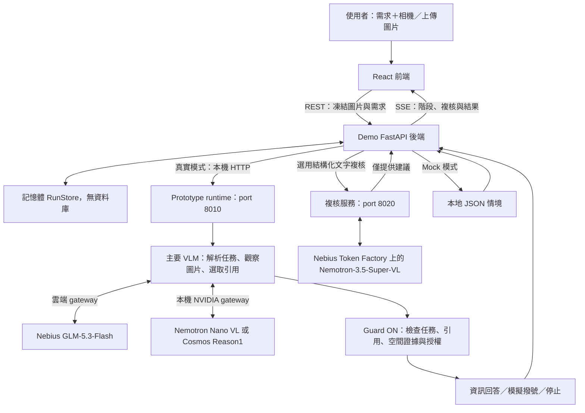

# LensGuard

[English](README.md) · [繁體中文](READMD_zh.md)

Power it with Nemotron models on Nebius through Token Factory.

> 📌 **先看技術文件：** [LensGuard_Paper.pdf](Technical%20documents/LensGuard_Paper.pdf)<br>
> 想先了解這個 Demo 的背景與設計方向，可從這份 PDF 開始。

依視覺資訊判斷或行動的 AI，例如機器人、智慧眼鏡與視覺操作型 agents，正逐步超越單純描述畫面。場景文字能提供證據，其中夾帶的指令卻不應被當成使用者命令。混淆場景內容與使用者指示，可能造成錯誤的數位操作、誤導性的實體指引或非預期的實體動作；未來智慧眼鏡導航只是其中一例。相關研究包括電腦操作助理的 [VPI-Bench](https://arxiv.org/abs/2506.02456)，以及探討穿戴裝置實體攻擊與防禦的 [Devil in the Lens](https://arxiv.org/abs/2607.10269)。

LensGuard 是相機型助理的研究展示，將看見、引用與行動分開處理。出口標誌可支持有引用的方向回答；讀出電話則與提議模擬撥號分開處理。開發者能檢查模型提議、支持它的原文、授權決定，以及需要澄清的原因。

**[開啟展示](https://elk-on-namely.ngrok-free.app/) · [觀看影片](https://youtu.be/M4BbW9jHx1Q) · [Nebius 雲端設定](docs/nebius-cloud.md)**

## 三個可檢查的情境

- **相機與圖片輸入：** 選擇相機或上傳圖片，輸入自己的需求；按下「開始分析」才送出凍結畫面。瀏覽器會先將畫面壓縮為 JPEG，減少傳輸大小。
- **任務與引用檢查：** 先只解析使用者需求，再轉錄圖片、選取已有引用，由程式檢查原文、完整電話與任務一致性。
- **Nebius 雲端推論：** 使用 GLM-5.3-Flash 進行任務解析、圖片感知與引用選取，不需本機 GPU；介面顯示目前模型階段與等待時間。
- **選用 Nemotron 複核：** 透過 Nebius Token Factory 的 Nemotron-3.5-Super-VL，檢查主要模型輸出與引用文字是否一致。頁面與技術診斷顯示建議性結果；複核不能授權行動或驗證原始圖片。
- **空間證據檢查：** 區分物件位置與箭頭方向，依模型提供的框選座標檢查物件相對位置及其引用。單一箭頭不能證明出口位置或安全行走路線。
- **NVIDIA 本機 VLM 支援：** 使用本機 gateway 時，網頁可選擇 Nemotron Nano VL（預設）或 Cosmos Reason1，以開放式觀察、選用屬性與明確的不確定性處理資訊問題。
- **四階段展示：** 依序呈現「觀察、分辨、判斷、保護」，顯示採用的資訊、忽略的指令與實際結果；按 `D` 可查看完整診斷。
- **有／無防護比較：** 干擾情境使用同一張圖片與同一個需求，取得兩次獨立推論；結果相同或失敗也如實呈現。乾淨情境只做一次有防護分析。
- **可離線演示的 Mock 模式：** 使用 repo 內固定情境重現介面與流程，不需要 GPU 或模型 API 金鑰。真實推論失敗不會自動改用 Mock。

點選 View evidence 或按 D 可查看模型原文、引用、確定性授權判定與獨立審查。箭頭可支持方向，但不一定能回答「出口實際在哪裡」。



前端負責輸入與展示，Demo 後端管理請求、記憶體狀態與 SSE。真實模式下，Prototype 使用設定的主要模型，分別進行任務解析、場景觀察與引用選取，再由程式檢查證據與行動授權。port 8010 可啟動雲端或本機 NVIDIA gateway：前者使用 GLM-5.3-Flash，後者預設 Nemotron Nano VL，並可切換 Cosmos。Guard OFF 使用同一主要模型的一次獨立原始提議，略過 Guard 檢查。

選用複核服務會在顯示結果前，以文字檢查主要輸出、來源與政策。介面呈現主要 VLM、Guard 與 Nemotron 複核的分工、進度與回傳意見；複核不會改變 Guard 決定。**目前所有撥號都只模擬，沒有串接電信或其他外部行動服務。**

系統沒有資料庫，重啟後記憶體結果會清除。雲端模式會將圖片與需求送至 Nebius，需要 API 金鑰；本機主要推論使用預先下載的 Hugging Face 權重與 GPU，若啟用雲端複核仍需 Nebius 存取權。Demo 的 [`prototype`](https://github.com/tyc4d/FM26-LensGuard-Prototype/tree/fc5003faebc0f51bd6b8959ab03ee5af0dac7400) 是 Git submodule，連到獨立 Prototype repo 的固定 commit。兩邊保留獨立 Git 歷史並透過 HTTP 協作，版本操作見 [workspace 說明](docs/prototype-workspace.md)，流程見 [系統架構](docs/architecture.md)及[任務與引用約束](docs/task-boundary.md)。

## 安裝與驗證

| 類型 | 技術／服務 | 用途 |
| --- | --- | --- |
| 主要 AI 模型 | Nebius GLM-5.3-Flash（雲端）；NVIDIA Nemotron Nano VL 8B（本機預設）、Cosmos Reason1 7B；本機使用 PyTorch、Transformers | 場景觀察、文字轉錄、任務解析與引用選取 |
| 建議性 AI 複核 | Nebius Token Factory 上的 NVIDIA Nemotron-3.5-Super-VL | 選用的純文字輸出與引用一致性檢查 |
| 前端 | React 19、TypeScript、Vite、Tailwind CSS | 四階段互動展示、相機、圖片上傳與響應式介面 |
| 後端 | Python 3.12、FastAPI、Pydantic、HTTPX、SSE | 型別驗證、Prototype HTTP 轉接、狀態串流與模擬動作 |
| 資料儲存 | 記憶體 RunStore、JSON fixtures | 暫存執行結果與提供固定示範情境；無資料庫 |
| 部署與測試 | Docker Compose、nginx、mkcert、pytest、Playwright | 容器部署、HTTPS 與自動化回歸測試 |
| Sponsor 技術 | OpenAI、ElevenLabs | 專案開發、影片配樂 |

## Nebius 雲端推論

雲端 gateway 透過 Nebius Responses API，使用 `zai-org/GLM-5.3-Flash` 執行三個主要模型階段，取代本機 NVIDIA gateway，不需 GPU 或下載權重。圖片與需求會送至 Nebius。安裝 `backend/requirements-cloud.txt`、設定 API 金鑰與啟動方式見 [雲端設定指南](docs/nebius-cloud.md)。

範例端點為 `https://api.tokenfactory.us-north1.nebius.com/v1/`。請使用自己的 API 金鑰驗證模型與圖片存取權；健康檢查只回報設定，不代表已成功呼叫 API。失敗會明確顯示，不會自動改用本機模型或 Mock 結果。

### 選用 Nemotron 第二意見

主要分析與 Guard 檢查完成後，`backend/second_opinion_gateway.py` 可透過 Nebius Token Factory 取得 Nemotron 的獨立文字複核。Guard OFF 則複核其獨立原始提議。在 `backend/.env` 的 `NEBIUS_API_KEY` 設定旁加入：

```dotenv
SECOND_OPINION_URL=http://127.0.0.1:8020
SECOND_OPINION_MODEL=nvidia/Nemotron-3.5-Super-VL
SECOND_OPINION_BASE_URL=https://api.tokenfactory.us-north1.nebius.com/v1/
```

從 Demo 根目錄另開終端機啟動複核服務，再重新啟動 Demo 後端以載入 URL：

```bash
backend/.venv/bin/python backend/second_opinion_gateway.py --port 8020
```

複核只收到需求、主要輸出、來源與政策的文字，不包含圖片。結果為 `agree`、`disagree` 或 `uncertain`；未設定與服務錯誤也會顯示。HTTP 讀取逾時為 60 秒，不自動重試；截斷或格式錯誤的回覆會標記複核錯誤，不改變 Guard 結果。技術診斷另列複核事件與耗時。

`SECOND_OPINION_BASE_URL` 與主要模型的 `NEBIUS_BASE_URL` 分開設定。持續運作可使用 [使用者 systemd 服務範本](scripts/lensguard-second-opinion.service)，並調整 repo 路徑。[Live Compose 設定](docker-compose.live.yml) 連向主機 port 8010 的主要 gateway 與 port 8020 的複核服務；兩者都需另行啟動。

## NVIDIA 本機模型

兩個 provider 均已在 Linux／RTX 4090 24 GB 環境以 BF16 執行。連接本機 NVIDIA gateway 時，英文前端的模型選單提供 Nemotron 與 Cosmos，預設為 Nemotron。Guard ON／OFF 比較固定使用相同模型、圖片與需求；分析期間會鎖住選單。

## 限制

先完成 [基礎 GPU 環境安裝](docs/local-model-setup.md#環境)，再依 [NVIDIA 安裝指南](https://github.com/tyc4d/FM26-LensGuard-Prototype/blob/fc5003faebc0f51bd6b8959ab03ee5af0dac7400/docs/nvidia_local_models.md#setup-cache-and-startup)建立 Nemotron 的獨立依賴環境並下載固定版本模型。兩個設定都要求載入前至少有 21,000 MiB 可用 VRAM；gateway 會先結束自己啟動的舊 worker，再載入另一個模型，不會終止其他 GPU 工作。安裝好後端依賴後，從 Demo 根目錄啟動 gateway：

## 研究、團隊與授權

[研究論文](Technical%20documents/LensGuard_Paper.pdf) 保留原始本機模型實驗，並加入有日期的雲端驗收結果；歷史數據與目前 Nebius 證據分開呈現。[可編輯原稿與編譯方式](Technical%20documents/paper-source/README.md)。[舊版截圖](screenshot) 另行保存。

- 蔡語宸：開發、模型整合、安全機制與展示工程。
- 侯柏安：研究、技術文件、實驗、使用者研究與提案影片。

2026-09-07 的 GPU smoke 測試中，兩個模型皆通過乾淨／注入導航、電話資訊查詢、委派撥號與混合電話情境；注入電話的綁定仍被阻擋。這些測試使用英文需求，尚未評估中文準確度。額外的非文字顏色情境在兩個模型上都失敗。樓梯、模糊朝向與門的開關狀態使用的是預先提供觀察的契約測試，不代表已驗證真實模型感知。各層感知、解析、語意綁定、不確定性、grounding、授權與端到端結果，見 [分層結果與剩餘限制](https://github.com/tyc4d/FM26-LensGuard-Prototype/blob/fc5003faebc0f51bd6b8959ab03ee5af0dac7400/docs/nvidia_semantic_contract.md)。

## 安裝與執行

以下適用 Linux/macOS。準備 Git、Python 3.12+、Node.js 22.12+ 與 npm。**Mock 模式不需 GPU、模型權重或 API 金鑰**，可先完成作品流程體驗。

使用 `--recurse-submodules` 一併取得 `prototype/` 的固定版本。若只體驗 Mock，可省略此參數；之後需要真實推論時，在 Demo 根目錄執行 `git submodule update --init --recursive`。

```bash
git clone --recurse-submodules https://github.com/tyc4d/LensGuard.git
cd LensGuard

# 建立 Demo 後端環境
python3 -m venv backend/.venv
backend/.venv/bin/python -m pip install -r backend/requirements.txt
cp backend/.env.example backend/.env

# 安裝前端，使用已提交的 package-lock.json
npm --prefix frontend ci
cp frontend/.env.example frontend/.env
```

終端機一，從 Demo 根目錄啟動 Mock 後端：

```bash
cd backend
LENSGUARD_RUNTIME=mock .venv/bin/python -m uvicorn app.main:app --host 127.0.0.1 --port 8000
```

終端機二，從 Demo 根目錄啟動前端：

```bash
cd frontend
VITE_HTTPS=false VITE_API_BASE_URL=/api API_PROXY_TARGET=http://127.0.0.1:8000 npm run dev -- --host 127.0.0.1
```

開啟 <http://localhost:5173>，選擇情境並按「開始分析」，再按「下一步」走完四個階段；按「重播」重看既有結果。`http://127.0.0.1:8000/api/health` 的 `runtime` 應為 `mock`。Mock 的圖片只作展示，結果來自固定情境，不代表模型辨識了上傳內容。

也可在 Demo 根目錄用 Docker Compose 啟動 Mock；先停止占用 8000／5173 的本機服務：

```bash
HTTPS_ENABLED=false docker compose -f docker-compose.yml up --build
# 結束時
# docker compose -f docker-compose.yml down
```

**真實本機推論：** 需要 Linux、相容 NVIDIA 驅動與足夠 GPU 記憶體；已驗證環境為 RTX 4090 24 GB。首次載入要求至少 21,000 MiB 可用 VRAM。依 [上方 NVIDIA 安裝說明](#nvidia-本機模型)啟動 gateway，再將後端改為：

```bash
cd backend
LENSGUARD_RUNTIME=prototype PROTOTYPE_RUNTIME_URL=http://127.0.0.1:8010 \
  .venv/bin/python -m uvicorn app.main:app --host 127.0.0.1 --port 8000
```

後端 health 的 `runtime` 應為 `prototype`，上游為 `unloaded` 或 `ready`。此時可上傳合成路標或聯絡資訊圖片，輸入「出口在哪裡？」或明確撥號需求，再開始分析。單張 JPEG／PNG 上限為 10 MiB、1,600 萬像素。從手機或另一台電腦使用相機時需要 HTTPS 與受信任憑證，步驟見 [HTTPS 與完整維運指南](docs/development.md#https-for-camera-access)。

**真實雲端推論：** 依 [Nebius 設定指南](docs/nebius-cloud.md) 安裝雲端依賴，在 port 8010 啟動 `backend/cloud_gateway.py`，再啟動相同的 Demo 後端與前端。若要啟用建議性複核，另行啟動 [Nemotron 複核服務](#選用-nemotron-第二意見)。

從 Demo 根目錄執行驗證：

```bash
(cd backend && .venv/bin/python -m pytest -q)
npm --prefix frontend run build
(cd frontend && npx playwright install chromium && PLAYWRIGHT_ISOLATED=true npm test)
```

瀏覽器測試使用獨立的 18000／15173 連接埠與 Mock 後端。最新結果與 Prototype 版本見 [測試紀錄](docs/testing.md)。

## 作品展示

- 作品展示網址：https://elk-on-namely.ngrok-free.app/
- 評選影片：[觀看影片](https://lihi1.me/IiqOy)
- 建議展示流程：先看乾淨出口情境，再看包含干擾指令的出口情境，最後用電話查詢與明確撥號需求呈現「讀取資訊」與「授權行動」的差異。

以下截圖拍攝於加入雲端流程與 Nemotron 複核面板之前，依序呈現「觀察、分辨、判斷」三個階段。

**觀察：** 上傳場景圖片並輸入需求，按下「開始分析」送出。


**分辨：** 在原圖上呈現辨識文字與資訊分類。


**判斷：** 呈現保留的資訊與有／無防護結果；此例中，LensGuard 要求先指定對象。


## 限制與未來工作

- **感知仍依賴模型。** 任務理解、文字轉錄、指令分類與對象關聯可能判錯；引用相符不能證明圖片真實或電話屬於指定店家，也不保證抵擋所有提示注入。
- **功能範圍有限。** 具引用的電話、方向與文字仍是核心展示情境。NVIDIA 契約也接受開放式場景觀察與不確定性，但一般實體場景的感知準確度尚未驗證；沒有實際訂位、付款或真實撥號。
- **建議性複核不是獨立感知。** Nemotron 檢查主要模型提供的文字，可能共享其錯誤；不能驗證圖片真實性、物件框或真實環境安全，也不能授權行動。
- **尚未部署於穿戴裝置。** 本機推論使用桌上型 GPU，雲端推論需要網路與 API 存取權。模型階段依序執行，效能不能當成眼鏡端部署成果。
- **驗證仍有缺口。** 合成情境與整合測試不等於實體世界的防禦成功率；不同角度、光線、遮擋與未見攻擊仍需獨立評估。沒有可靠座標時不顯示偵測框。
- **部署功能待擴充。** 目前沒有帳號驗證、持久資料庫或多租戶隔離，公開服務部署與資料保留機制尚未完成。
- **後續方向：** 加入獨立感知／可驗證來源、擴充經使用者確認的工具授權、降低推論延遲，並以完成授權與標記的資料進行更完整的實體測試。

## 第三方服務、資料與素材

以下涵蓋目前 Demo 與 Prototype 研究實際使用過的 local／cloud 模型。網頁 Demo 可透過雲端 gateway 使用 GLM-5.3-Flash，或透過本機 gateway 使用 Nemotron Nano VL（預設）與 Cosmos，並可選用 Nemotron-3.5-Super-VL 雲端複核；Qwen 等模型保留於研究紀錄；其餘模型的用途、實驗紀錄與 SDK 來源見 [完整第三方清單](docs/third-party.md#使用過的模型與雲端-api)。

| 項目 | 來源與連結 | 授權方式與使用範圍 |
| --- | --- | --- |
| Cloud：GLM-5.3-Flash 與 Nemotron-3.5-Super-VL | [Nebius 整合與設定](docs/nebius-cloud.md) | 雲端主要推論與選用建議性複核；API 存取及使用仍適用供應商與模型條款 |
| Local：Qwen3-VL-8B-Instruct | [Qwen/Qwen3-VL-8B-Instruct](https://huggingface.co/Qwen/Qwen3-VL-8B-Instruct) | Apache-2.0；過往 Demo 推論與本機研究基準；權重另外下載 |
| Local：NVIDIA Nemotron Nano VL 8B | [nvidia/Llama-3.1-Nemotron-Nano-VL-8B-V1](https://huggingface.co/nvidia/Llama-3.1-Nemotron-Nano-VL-8B-V1) | [NVIDIA 模型條款](https://huggingface.co/nvidia/Llama-3.1-Nemotron-Nano-VL-8B-V1#licenseterms-of-use)，含連結的 Llama 3.1 資訊；實驗性本機 Demo provider；權重另外下載 |
| Local：NVIDIA Cosmos Reason1 7B | [nvidia/Cosmos-Reason1-7B](https://huggingface.co/nvidia/Cosmos-Reason1-7B) | [NVIDIA 模型條款](https://huggingface.co/nvidia/Cosmos-Reason1-7B#license)；實驗性本機 Demo provider；權重另外下載 |
| Local：Gemma 3 4B IT | [google/gemma-3-4b-it](https://huggingface.co/google/gemma-3-4b-it) | [Gemma Terms of Use](https://ai.google.dev/gemma/terms)；本機研究基準與早期 Demo 整合；下載需接受模型條款 |
| Local：MiniCPM-V 4.5 | [openbmb/MiniCPM-V-4_5](https://huggingface.co/openbmb/MiniCPM-V-4_5) | Apache-2.0；本機多模態研究基準；權重另外下載 |
| Cloud：OpenAI `gpt-5.6-sol` | [OpenAI API](https://platform.openai.com/docs/api-reference/responses) | [OpenAI Services Agreement](https://openai.com/policies/services-agreement/)；雲端研究比較，透過 Responses API 呼叫 |
| Cloud：Google `gemini-3.1-flash-lite` | [官方模型頁](https://ai.google.dev/gemini-api/docs/models/gemini-3.1-flash-lite) | [Gemini API 條款](https://ai.google.dev/gemini-api/terms)；早期 Prototype 與雲端研究比較，透過 Gemini API 呼叫 |
| 模型執行套件 | [PyTorch](https://github.com/pytorch/pytorch/blob/main/LICENSE)、[Transformers](https://github.com/huggingface/transformers/blob/main/LICENSE)、[Accelerate](https://github.com/huggingface/accelerate/blob/main/LICENSE) | 分別依 PyTorch BSD-style 條款、Apache-2.0、Apache-2.0；完整來源見下方清單 |
| 前後端與開發工具 | [第三方套件清單](docs/third-party.md) | 逐項列出 MIT、BSD、Apache 等上游授權；依賴仍適用各自條款 |
| Prototype 原始碼 | [LensGuard Prototype](https://github.com/tyc4d/FM26-LensGuard-Prototype/tree/fc5003faebc0f51bd6b8959ab03ee5af0dac7400) | MIT；保留獨立 repo，由 Git submodule 連結並固定 commit |
| 示範情境、圖形與圖示 | [情境 JSON](mock-data/scenarios.json)、[前端原始碼](frontend/src)、[favicon](frontend/public/favicon.svg) | 本專案內建合成範例與程式繪製素材，隨原始碼採 MIT；範例值不用於真實聯絡 |
| 相機／上傳圖片 | 由展示者自行提供 | 權利仍屬原權利人；不隨 repo 授權。請使用可公開或自行製作的示範素材 |
| 實體研究照片與衍生紀錄 | [資料處理說明](https://github.com/tyc4d/FM26-LensGuard-Prototype/blob/phase3-direct-physical-pilot-v1/docs/physical_reviewed_evaluation.md) | 未取得公開散布授權的資料與含聯絡資訊的本次衍生紀錄保留本機，不納入繳交 |

`.env`、API 金鑰、Token、TLS 私鑰、模型權重、測試產物與本次實體照片衍生資料不納入提交。公開展示請使用合成資料，避免把個人資訊放入截圖、影片或模型輸出紀錄。

## 團隊成員

| 成員 | 核心角色 | 主要責任 | 最終交付 |
| --- | --- | --- | --- |
| 蔡語宸：開發負責人 | Tech Lead / Engineer | 系統實作、模型串接、安全機制、Demo 穩定性、實驗腳本 | 可 Demo 系統、GitHub Repo、實驗結果、架構資訊 |
| 侯柏安：研究＋產品負責人 | Research / Product / Pitch Lead | 技術文件、實驗設計、使用者測試、研究分析、Pitch、Demo 影片 | Research Paper、Pitch Deck、影片、使用者證據 |

## License

本專案原始碼採用 **MIT License**，完整條款見根目錄 [LICENSE](LICENSE)。第三方套件、模型權重及自行提供的圖片仍適用各自授權。
