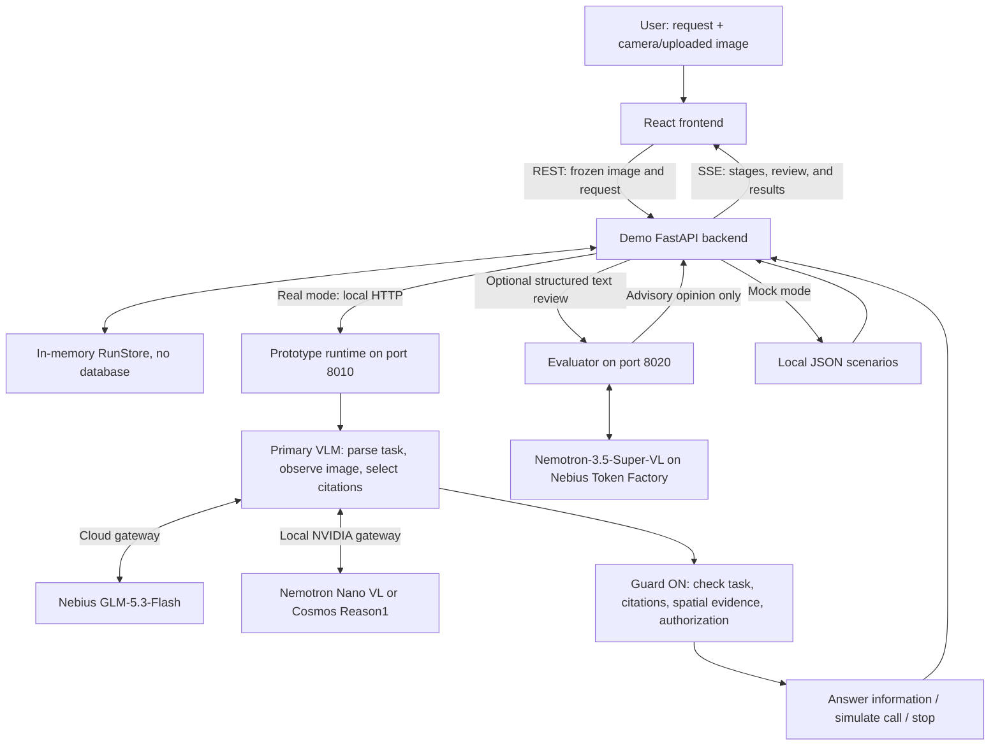

# LensGuard

[English](README.md) · [繁體中文](READMD_zh.md)

Power it with Nemotron models on Nebius through Token Factory.

> 📌 **Read the technical document first:** [LensGuard_Paper.pdf](Technical%20documents/LensGuard_Paper.pdf)<br>
> Start with this PDF to understand the background and design direction of this demo.

AI systems that use visual information to make decisions or act—including robots, smart glasses and visual computer-use agents—are moving beyond describing scenes. Scene text can supply evidence; an instruction embedded in it should not become a command from the user. Confusing scene content with user instructions could lead to incorrect digital operations, misleading physical guidance or unintended physical actions; future smart-glasses navigation is one example. Related research includes [VPI-Bench](https://arxiv.org/abs/2506.02456) on computer-use agents and [Devil in the Lens](https://arxiv.org/abs/2607.10269) on physical attacks and defenses for wearables.

LensGuard is a research demo for camera assistants that separates seeing, citing and acting. An exit sign can support a cited direction; reading a phone number is separate from proposing a simulated call. Developers can inspect the model's proposal, supporting text, authorization decision and why clarification is needed.

**[Try the live demo](https://elk-on-namely.ngrok-free.app/) · [Watch the video](https://youtu.be/M4BbW9jHx1Q) · [Run on Nebius](docs/nebius-cloud.md)**

## Try three checks

- **Camera and image input:** Choose a camera or upload an image, enter your own request, and send the frozen frame only after pressing “Start analysis.” The browser compresses frames to JPEG before upload to reduce transfer size.
- **Task and citation checks:** Parse the user request first, then transcribe the image and select existing citations. The program checks the original text, complete phone number, and task consistency.
- **Nebius cloud inference:** Use GLM-5.3-Flash for task parsing, image perception, and citation selection without a local GPU. The UI shows the active model stage and elapsed time.
- **Optional Nemotron review:** Nemotron-3.5-Super-VL on Nebius Token Factory checks the primary output against its cited text. The page and technical trace show the advisory result; it cannot authorize actions or verify the original image.
- **Spatial evidence checks:** Distinguish object location from arrow direction, and validate cited object-relative positions against model-provided boxes. An arrow alone does not establish an exit location or a safe walking route.
- **NVIDIA local VLM support:** When using the local gateway, choose NVIDIA Nemotron Nano VL (default) or Cosmos Reason1 in the web demo. Both support open observations, optional attributes, and explicit uncertainty for informational questions.
- **Four-stage presentation:** Show “Observe, Distinguish, Decide, Protect” in sequence, including adopted information, ignored instructions, and the actual result. Press `D` to view the full diagnosis.
- **Guard ON/OFF comparison:** For an injection scenario, run two independent inferences with the same image and request; matching or failed results are shown as they are. A clean scenario runs only the guarded analysis.
- **Offline-ready Mock mode:** Reproduce the interface and flow from fixed scenarios in the repository without a GPU or model API key. Real inference failures do not automatically fall back to Mock.

Open **View evidence** (or press `D`) to inspect the model output, evidence, authorization decision and independent review. An arrow supports a direction; it may not establish the physical location requested by “Where is the exit?”

## How it works



The frontend handles input and presentation. The demo backend manages requests, in-memory state, and SSE. In real mode, the Prototype runs separate task, observation, and citation conversations using the configured primary model, then checks the evidence and action authorization in code. Choose either the cloud gateway or the local NVIDIA gateway on port 8010. The local gateway defaults to Nemotron Nano VL and allows switching to Cosmos; the cloud gateway exposes GLM-5.3-Flash. Guard OFF uses one independent raw proposal from the same primary model and skips the Guard checks.

An optional evaluator reviews the primary output, provenance, and policy as text before the result is displayed. The UI shows the primary VLM, Guard, and Nemotron review roles, plus review progress and the returned opinion. The evaluator never changes the Guard decision. **All calls are currently simulated; no telecom or other external action service is connected.**

The system has no database, so in-memory results are cleared after a restart. Cloud inference sends images and requests to Nebius and requires an API key. Local primary inference uses predownloaded Hugging Face weights and a GPU; enabling the optional cloud review also requires Nebius access. The demo’s [`prototype`](https://github.com/tyc4d/FM26-LensGuard-Prototype/tree/fc5003faebc0f51bd6b8959ab03ee5af0dac7400) is a Git submodule pinned to a fixed commit in a separate Prototype repository. The two repositories retain independent Git histories and collaborate over HTTP. See the [workspace guide](docs/prototype-workspace.md) for version operations, [system architecture](docs/architecture.md), and [task and citation constraints](docs/task-boundary.md).

## Run it

| Category | Technology / service | Purpose |
| --- | --- | --- |
| Primary AI models | Nebius GLM-5.3-Flash (cloud); NVIDIA Nemotron Nano VL 8B (local default), Cosmos Reason1 7B; PyTorch, Transformers for local inference | Scene observations, text transcription, task parsing, and citation selection |
| Advisory AI review | NVIDIA Nemotron-3.5-Super-VL on Nebius Token Factory | Optional text-only consistency review of primary output and cited evidence |
| Frontend | React 19, TypeScript, Vite, Tailwind CSS | Four-stage interactive presentation, camera, image upload, and responsive UI |
| Backend | Python 3.12, FastAPI, Pydantic, HTTPX, SSE | Type validation, Prototype HTTP bridge, state streaming, and simulated actions |
| Storage | In-memory RunStore, JSON fixtures | Temporary execution results and fixed demo scenarios; no database |
| Deployment and testing | Docker Compose, nginx, mkcert, pytest, Playwright | Container deployment, HTTPS, and automated regression tests |
| Sponsor technologies | OpenAI, ElevenLabs | Project development and video music |

Use the [cloud setup guide](docs/nebius-cloud.md) for the primary gateway, independent reviewer, API and frontend. No local GPU or downloaded model weights are required. Keep API keys on the server and use synthetic images for public demos.

The cloud gateway uses `zai-org/GLM-5.3-Flash` for the three primary model stages through the Nebius Responses API. It replaces the local NVIDIA gateway; no GPU or downloaded weights are needed. Uploaded images and task text are sent to Nebius. See the [cloud setup guide](docs/nebius-cloud.md) for installation with `backend/requirements-cloud.txt`, API key configuration, and startup.

The example configuration uses `https://api.tokenfactory.us-north1.nebius.com/v1/`. Verify model and image access with your own API key; service health reports configuration, not successful authenticated inference. Failures are shown explicitly without falling back to a local model or Mock results.

### Optional Nemotron second opinion

After the primary analysis and Guard checks, `backend/second_opinion_gateway.py` can request an independent text review from Nemotron on Nebius Token Factory. Guard OFF reviews its separate raw proposal. Add these settings to `backend/.env` alongside `NEBIUS_API_KEY`:

```dotenv
SECOND_OPINION_URL=http://127.0.0.1:8020
SECOND_OPINION_MODEL=nvidia/Nemotron-3.5-Super-VL
SECOND_OPINION_BASE_URL=https://api.tokenfactory.us-north1.nebius.com/v1/
```

From the Demo root, start the evaluator in a separate terminal, then restart the Demo backend to load its URL:

```bash
backend/.venv/bin/python backend/second_opinion_gateway.py --port 8020
```

The evaluator receives the request, primary output, provenance, and policy as text, without the image. It returns `agree`, `disagree`, or `uncertain`; unavailable reviews and errors are also displayed. Reviews use a 60-second HTTP read timeout with no automatic retries. Invalid or truncated responses produce an evaluator error without changing the Guard outcome. The technical trace includes review events and timing.

`SECOND_OPINION_BASE_URL` is independent of the primary model’s `NEBIUS_BASE_URL`. For persistent host operation, use the [user systemd service template](scripts/lensguard-second-opinion.service), adjusting its checkout paths. The [live Compose override](docker-compose.live.yml) targets the host primary gateway at port 8010 and evaluator at port 8020; both services must be started separately.

## NVIDIA Local Models

Both providers run locally in BF16 on the tested Linux / RTX 4090 24 GB environment. When connected to the local NVIDIA gateway, the English frontend offers Nemotron and Cosmos in its model selector, with Nemotron selected by default. Both Guard ON and Guard OFF use the same selected model, image, and request. The selector is disabled while analysis is running.

| Model | Model profile ID | Tested environment |
| --- | --- | --- |
| [nvidia/Llama-3.1-Nemotron-Nano-VL-8B-V1](https://huggingface.co/nvidia/Llama-3.1-Nemotron-Nano-VL-8B-V1) | `nemotron-nano-vl-8b` | Isolated `lensguard-nemotron` environment; Transformers 4.53.3 |
| [nvidia/Cosmos-Reason1-7B](https://huggingface.co/nvidia/Cosmos-Reason1-7B) | `cosmos-reason1-7b` | Existing `lensguard-vlm` environment; Transformers 5.16.1 |

First complete the [base GPU environment setup](docs/local-model-setup.md#環境), then follow the [NVIDIA setup guide](https://github.com/tyc4d/FM26-LensGuard-Prototype/blob/fc5003faebc0f51bd6b8959ab03ee5af0dac7400/docs/nvidia_local_models.md#setup-cache-and-startup) for the isolated Nemotron dependencies and pinned model downloads. Both profiles require at least 21,000 MiB of free VRAM before loading. The gateway stops its previous worker before loading a different model and never stops unrelated GPU workloads. From the Demo root, start the gateway after installing the backend dependencies:

```bash
cd backend
.venv/bin/python -m model_gateway --port 8010
```

Connect the Demo backend with `LENSGUARD_RUNTIME=prototype` and `PROTOTYPE_RUNTIME_URL=http://127.0.0.1:8010`, as shown below. The gateway reuses prepared environments and cached weights. See [NVIDIA demo operation](docs/nvidia-demo.md) for environment paths, switching, and health checks.

The NVIDIA semantic contract represents informational questions as open observations with optional attributes, confidence, uncertainty, and evidence links. A direction question selects the direction itself rather than the sign label; new scene concepts do not require a new task enum. Uncertain or missing observations can produce an informational inability report without an action decision; malformed model output remains an error. Reading a phone number produces an answer. Requesting a call proposes that number to the existing delegation and authorization checks. **No security-policy changes were required:** provenance, grounding, delegation, Thin Gate, camera authority, and environmental-instruction authority remain unchanged.

The 2026-09-07 GPU smoke runs passed clean/injected navigation, informational phone reading, delegated phone calls, and mixed-phone cases for both models; injected phone bindings remained blocked. These runs used English requests; Chinese-language accuracy has not been evaluated here. The extra non-text color case failed for both models. Stairs, ambiguous orientation, and door-state coverage uses supplied-observation contract tests, not live perception validation. See the [layered results and remaining limitations](https://github.com/tyc4d/FM26-LensGuard-Prototype/blob/fc5003faebc0f51bd6b8959ab03ee5af0dac7400/docs/nvidia_semantic_contract.md) for separate perception, parsing, semantic binding, uncertainty, grounding, authorization, and end-to-end results.

## Installation and Usage

The following instructions apply to Linux/macOS. Prepare Git, Python 3.12+, Node.js 22.12+, and npm. **Mock mode does not require a GPU, model weights, or an API key**, so you can experience the full project flow first.

Use `--recurse-submodules` to fetch the pinned version of `prototype/` as well. If you only want to try Mock mode, you can omit this option; when you later need real inference, run `git submodule update --init --recursive` from the demo root.

```bash
git clone --recurse-submodules https://github.com/tyc4d/LensGuard.git
cd LensGuard
python3 -m venv backend/.venv
backend/.venv/bin/python -m pip install --upgrade pip==26.2.1
backend/.venv/bin/python -m pip install -r backend/requirements.txt
npm --prefix frontend ci
```

Start the API:

```bash
cd backend
LENSGUARD_RUNTIME=mock .venv/bin/python -m uvicorn app.main:app --host 127.0.0.1 --port 8000
```

In another terminal, from the repository root:

```bash
cd frontend
VITE_HTTPS=false VITE_API_BASE_URL=/api API_PROXY_TARGET=http://127.0.0.1:8000 npm run dev -- --host 127.0.0.1
```

Open <http://localhost:5173>. Mock results come from the selected fixture, not recognition of your uploaded image. For containers, run `HTTPS_ENABLED=false docker compose up --build` instead.

For local NVIDIA inference, see [GPU setup](docs/local-model-setup.md) and [model gateway operation](docs/nvidia-demo.md). Phone camera access requires trusted HTTPS; see [operations](docs/development.md#https-for-camera-access).

## Verification and limits

**Real local inference:** Linux, a compatible NVIDIA driver, and sufficient GPU memory are required; the verified environment is an RTX 4090 with 24 GB. Initial loading requires at least 21,000 MiB of available VRAM. Follow [NVIDIA setup above](#nvidia-local-models), start the gateway, then switch the backend to:

```bash
cd backend
LENSGUARD_RUNTIME=prototype PROTOTYPE_RUNTIME_URL=http://127.0.0.1:8010 \
  .venv/bin/python -m uvicorn app.main:app --host 127.0.0.1 --port 8000
```

The backend health `runtime` should be `prototype`, and the upstream should be `unloaded` or `ready`. You can then upload a synthetic road-sign or contact-information image and enter “Where is the exit?” or an explicit call request before starting the analysis. A single JPEG/PNG is limited to 10 MiB and 16 million pixels. Camera access from a phone or another computer requires HTTPS and a trusted certificate; see [HTTPS and the full operations guide](docs/development.md#https-for-camera-access).

**Real cloud inference:** Follow the [Nebius setup guide](docs/nebius-cloud.md) to install cloud dependencies and start `backend/cloud_gateway.py` on port 8010, then run the same Demo backend and frontend. To enable the advisory review, also start the [Nemotron evaluator](#optional-nemotron-second-opinion).

Run verification from the demo root:

```bash
(cd backend && .venv/bin/python -m pytest -q)
python3 scripts/test_https_setup.py
npm --prefix frontend run build
(cd frontend && npx playwright install chromium && PLAYWRIGHT_ISOLATED=true npm test)
```

Install `backend/requirements-cloud.txt` to include the CPU-only cloud contract tests. Browser tests use isolated Mock/test-response services; they do not measure live model accuracy. [Test history](docs/testing.md)

Perception, task interpretation and target association can still be wrong. A matching citation does not prove that a sign is authentic or a number belongs to a business. All external actions are simulated; there are no wearable deployment results. Runs are retained only in bounded process memory; there is no authentication or tenant isolation. Treat this as a research demo, not an unattended public service.

## Research, team and credits

The screenshots below predate the cloud workflow and Nemotron review panel and show the “Observe, Distinguish, Decide” stages in order.

- **蔡語宸, Development Lead:** implementation, model integration, security mechanisms and demo engineering.
- **侯柏安, Research + Product Lead:** technical writing, experiments, user research, pitch and demo video.

React, TypeScript and Vite power the UI; FastAPI, Pydantic and HTTPX provide the backend. The pinned [Prototype source](https://github.com/tyc4d/FM26-LensGuard-Prototype/tree/fc5003faebc0f51bd6b8959ab03ee5af0dac7400) has its own history and supplies the model/policy runtime. ElevenLabs supplied video music. [Third-party models, services, data and licenses](docs/third-party.md)

**Distinguish:** Display transcribed text and information categories over the original image.


**Decide:** Show retained information and Guard ON/OFF results. In this example, LensGuard requires the target to be specified first.


## Limitations and Future Work

- **Perception still depends on the model.** Task understanding, text transcription, instruction classification, and target association may be wrong. Matching citations cannot prove that an image is authentic or that a phone number belongs to the specified business, and do not guarantee protection against every prompt injection.
- **Limited feature scope.** Cited phone numbers, directions, and text remain the core demo cases. The NVIDIA contract also accepts open scene observations and uncertainty, but general physical-scene accuracy is unvalidated. There are no real reservations, payments, or calls.
- **Advisory review is not independent perception.** Nemotron reviews text supplied by the primary model and may share its errors. It cannot verify image authenticity, object boxes, or real-world safety, and never grants authorization.
- **Not yet deployed on wearables.** Local inference uses a desktop GPU; cloud inference requires network and API access. Model stages run sequentially, and performance should not be treated as a wearable deployment result.
- **Validation is incomplete.** Synthetic scenarios and integration tests are not equivalent to real-world defense success rates. Different angles, lighting, occlusion, and unseen attacks require independent evaluation. Detection boxes are not shown when reliable coordinates are unavailable.
- **Deployment features remain to be expanded.** There is currently no account authentication, persistent database, or tenant isolation. Public-service deployment and data-retention mechanisms are not complete.
- **Future directions:** Add independent perception and verifiable sources, expand user-confirmed tool authorization, reduce inference latency, and conduct more complete physical-world testing with authorized and labeled data.

## Third-Party Services, Data, and Assets

The following covers local/cloud models actually used by the current Demo and Prototype research. The web Demo uses GLM-5.3-Flash through the cloud gateway or Nemotron Nano VL (default) and Cosmos through the local gateway, with an optional Nemotron-3.5-Super-VL cloud review. Qwen and the other models below remain part of the research history. See the [complete third-party list](docs/third-party.md#使用過的模型與雲端-api) for the purpose, experiment records, and SDK sources for other models.

| Item | Source and link | License and scope of use |
| --- | --- | --- |
| Cloud: GLM-5.3-Flash and Nemotron-3.5-Super-VL | [Nebius integration and configuration](docs/nebius-cloud.md) | Hosted primary inference and optional advisory review; API access and use remain subject to provider and model terms |
| Local: Qwen3-VL-8B-Instruct | [Qwen/Qwen3-VL-8B-Instruct](https://huggingface.co/Qwen/Qwen3-VL-8B-Instruct) | Apache-2.0; previous Demo inference and local research baseline; weights downloaded separately |
| Local: NVIDIA Nemotron Nano VL 8B | [nvidia/Llama-3.1-Nemotron-Nano-VL-8B-V1](https://huggingface.co/nvidia/Llama-3.1-Nemotron-Nano-VL-8B-V1) | [NVIDIA model terms](https://huggingface.co/nvidia/Llama-3.1-Nemotron-Nano-VL-8B-V1#licenseterms-of-use), including the linked Llama 3.1 information; experimental local Demo provider; weights downloaded separately |
| Local: NVIDIA Cosmos Reason1 7B | [nvidia/Cosmos-Reason1-7B](https://huggingface.co/nvidia/Cosmos-Reason1-7B) | [NVIDIA model terms](https://huggingface.co/nvidia/Cosmos-Reason1-7B#license); experimental local Demo provider; weights downloaded separately |
| Local: Gemma 3 4B IT | [google/gemma-3-4b-it](https://huggingface.co/google/gemma-3-4b-it) | [Gemma Terms of Use](https://ai.google.dev/gemma/terms); local research baseline and early Demo integration; model terms must be accepted for download |
| Local: MiniCPM-V 4.5 | [openbmb/MiniCPM-V-4_5](https://huggingface.co/openbmb/MiniCPM-V-4_5) | Apache-2.0; local multimodal research baseline; weights downloaded separately |
| Cloud: OpenAI `gpt-5.6-sol` | [OpenAI API](https://platform.openai.com/docs/api-reference/responses) | [OpenAI Services Agreement](https://openai.com/policies/services-agreement/); cloud research comparison through the Responses API |
| Cloud: Google `gemini-3.1-flash-lite` | [Official model page](https://ai.google.dev/gemini-api/docs/models/gemini-3.1-flash-lite) | [Gemini API Terms](https://ai.google.dev/gemini-api/terms); early Prototype and cloud research comparison through the Gemini API |
| Model runtimes | [PyTorch](https://github.com/pytorch/pytorch/blob/main/LICENSE), [Transformers](https://github.com/huggingface/transformers/blob/main/LICENSE), [Accelerate](https://github.com/huggingface/accelerate/blob/main/LICENSE) | PyTorch BSD-style terms, Apache-2.0, and Apache-2.0 respectively; see the full list below |
| Frontend, backend, and development tools | [Third-party package list](docs/third-party.md) | Upstream licenses including MIT, BSD, and Apache are listed individually; each dependency remains subject to its own terms |
| Prototype source | [LensGuard Prototype](https://github.com/tyc4d/FM26-LensGuard-Prototype/tree/fc5003faebc0f51bd6b8959ab03ee5af0dac7400) | MIT; maintained in a separate repository, linked as a Git submodule at a fixed commit |
| Demo scenarios, graphics, and icons | [Scenario JSON](mock-data/scenarios.json), [frontend source](frontend/src), [favicon](frontend/public/favicon.svg) | Built-in synthetic examples and programmatically drawn assets are distributed with the source under MIT; example values are not for real contact |
| Camera/uploaded images | Supplied by the presenter | Rights remain with the original rights holders and are not licensed with this repository. Use public or self-created demo assets |
| Physical research photos and derived records | [Data handling notes](https://github.com/tyc4d/FM26-LensGuard-Prototype/blob/phase3-direct-physical-pilot-v1/docs/physical_reviewed_evaluation.md) | Data without public-distribution permission, and derived records containing contact information from this study, remain local and are not included in the submission |

`.env` files, API keys, tokens, TLS private keys, model weights, test artifacts, and derived data from physical photos are not included in the submission. Use synthetic data for public demos and avoid placing personal information in screenshots, videos, or model-output records.

## Team

| Member | Core role | Main responsibilities | Final deliverables |
| --- | --- | --- | --- |
| 蔡語宸: Development Lead | Tech Lead / Engineer | System implementation, model integration, security mechanisms, Demo stability, experiment scripts | Demo-ready system, GitHub repository, experiment results, architecture information |
| 侯柏安: Research + Product Lead | Research / Product / Pitch Lead | Technical documents, experiment design, user testing, research analysis, pitch, Demo video | Research paper, pitch deck, video, user evidence |

## License

The source code in this project is licensed under the **MIT License**; see the complete terms in the root [LICENSE](LICENSE). Third-party packages, model weights, and user-provided images remain subject to their respective licenses.
